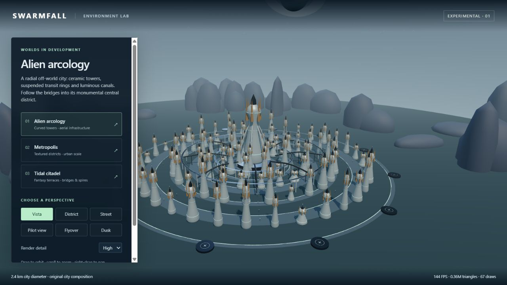

# First Environment Lab — preserved October 16, 2026

Codex's original three-study gallery, committed as `598e3b9` by Claude during Codex's usage
limit. Exact original HTML/CSS/JS/world composition and credits are preserved here, with an
alien-city screenshot. The original model assets remain in `dist/invasion/environments/assets/`
and in that commit; they have not been removed.

The continuation adds two complete source-city experiments and fixes the pilot-to-flyover
transition. The first three compositions remain available. This snapshot preserves the earlier
menu and behavior rather than overwriting their only copy.

Restore by copying these five source files back into `dist/invasion/environments/` after first
archiving any later edits. Alternatively use a separate checkout at `598e3b9` to inspect the
entire exact version. Keep current source-city exports and source archives; restoring old
controls does not require deleting assets. Tag: `archive/environment-lab-v1-2026-10-16`.

Additional preserved drafts:
- `coastal-foundation-draft/`: first raised platform; `platform-pass-1.png` is a new re-render.
- `partial-contour-draft/`: second low-coast pass and original low-only contact selection;
  `platform-pass-2.png` is a new re-render. This is the owner's preferred baseline.
- `over-raised-contour-draft/`: rejected full-height contact envelope and screenshot; it
  swallowed architecture despite passing gap checks. Keep for diagnosis, not as the default.

The first two are also viewable in the current gallery using `foundation=platform-v1` and
`foundation=contour-v2`. Runtime historical modules adjust only their relative vendor import
path. Restoring a draft does not require deleting current or original asset files.
