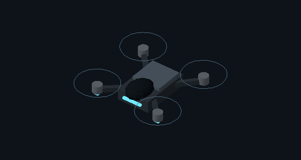

# Scout before its first small-asset polish pass

Preserved October 19, 2026 — **Codex (OpenAI)**.
Baseline `47281699e4bb8884ebe403479d7e419b49e29454`, tag
`archive/scout-polish-2026-10-19`.

`original/models.mjs` is the exact prior model source. Scout used a rectangular body, dark
sensor sphere, top plate and four simple motor arms. Other drone/defender/structure templates
are retained in that complete source file as well. `baseline-inventory.json` preserves the
six-template inventory from the prior planning step; `baseline-geometry.json` stores the
actual Scout body/glow/rotor data exported before replacement.

This image is a new CPU projection of the exact exported old geometry, not a browser
screenshot. Static rotor outlines illustrate anchors, not animated rotor shading. The
preview uses simple Lambert lighting rather than the game's materials/shadows/effects.
`drafts/flush-sensor-models.mjs` retains the first unpublished lens draft; it was adjusted
to use an open housing, annular rim and recessed lens before review.

Use the tag in a separate checkout to reproduce the original. For a selective restore,
compare only the Scout function/helper in `original/models.mjs` with `dist/invasion/models.mjs`;
restoring the whole file may overwrite later changes to other models. Preserve current work
and saves first. The comparison/export script is in the linked research folder. Keep all
archives, downloaded source assets, authoring receipts and untracked kit drafts.

[Polish pass, CPU comparison and checks](../../research/scout-polish-2026-10-19/README.md).
