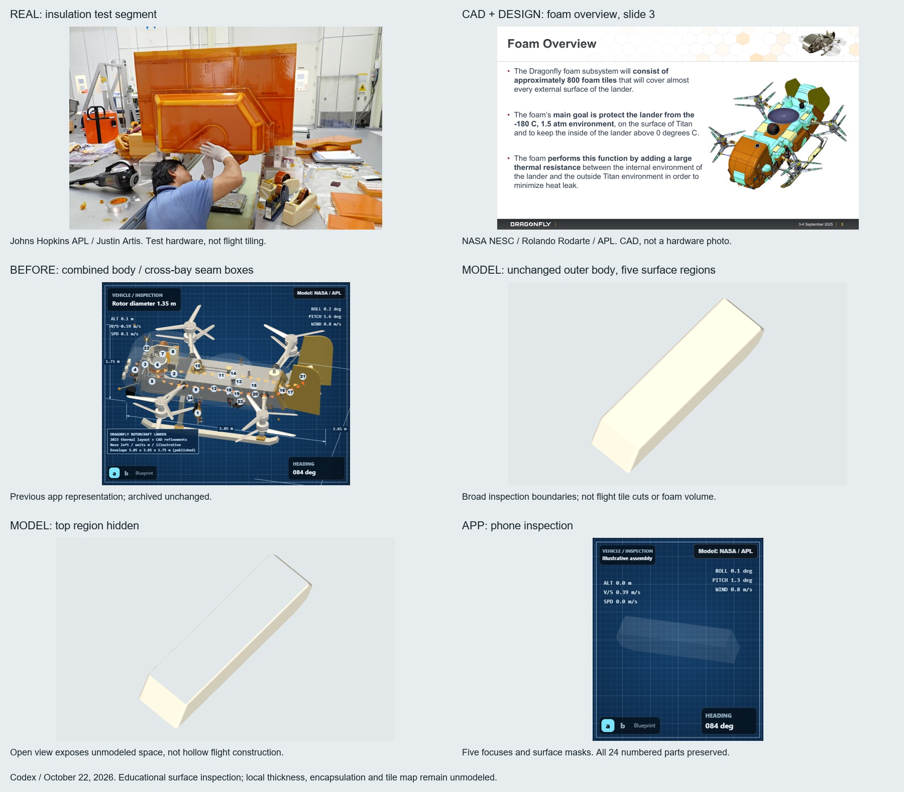

# Body insulation: removable surface regions

Codex (OpenAI), October 22, 2026. One construction-access pass, not a new numbered part.

## Evidence first

[Original photo, source links, credits and saved slide pages](../sources/nasa-foam-2025/README.md).
The real September2025 test hardware is the appearance/construction evidence; NESC's
May2026 design slides add material selection, approximate tile count and test context.
CAD is labeled CAD, not used as a substitute real-hardware photograph.

- [PUB] NASA2025: nominal3-inch/7.6cm Solimide-based body insulation.
- [PUB] NESC2026: selected Solimide16; roughly800tiles; feature-limit tests,
  load-path-dependent encapsulation, venting and contamination testing.
- [EST] The existing body profile, color/finish and five broad inspection boundaries.
  Not an800-tile layout or a verified installed flight assembly.
- Historical Rohacell references remain historical, not the current blanket body selection.
  Do not change HGA core/local foam materials without source-specific evidence.

## Implementation

`dist/body-foam.mjs` makes the same old beveled extrusion, then distributes its original
triangles by dominant geometric face normal into top/deck, port, starboard, belly and ends.
Positions, normals, UVs and winding are retained. Each region is a separate unnumbered
focus and global mask. `body-shell` remains the aggregate; `insulation` now includes these
five surfaces. Walls, deck and24 equipment parts remain independently installed.

Three old solid cross-bay seam boxes are retired and preserved in the archive. The base
body is exact; old seam protrusions are intentionally removed. No geometry is added inside
the bay. These are **surface-only masks**, not foam volumes, a continuous inner liner,
actual flight tile cuts, membrane stack, adhesive pattern, vents or verified disassembly.
Empty space exposed by hiding them is unmodeled, not a claim about hollow flight hardware.
Nominal source thickness is recorded but not applied locally as an arbitrary inward offset.

Thermal uses the same shared shell node. No solver, mass, physics, temperatures or
controller changes. The new Solimide test-property evidence belongs in a separately scoped
audit of legacy preliminary conductivity/UA and installation assumptions.

## Archive and verification

[Archive / recovery steps](../../archive/body-foam-2026-10-22/README.md), tag onf14f2f0.
Before files, six screenshots and exact hardware/base-surface manifests were captured first.

- Six new unit tests: exact original attributes/triangle partition, allfive nonempty
  directions, indexed-input preservation, surface-only metadata/material/numbering,
  independent/aggregate masks/restore and finite unchanged base bounds.
- Existing renderer smoke test now includes two body-region masks with draw-time restore
  and Pilot return. Initial complete suite **519 pass, zero failures**.
- Local real Edge: **36** region/layer/viewport cases (all+five focuses, Internal/Thermal,
  1440/390/360px); no page errors, failed requests or horizontal overflow.
- All24 equipment plus walls/joints/deck/attic geometry/transforms match before manifests.
  Original outer base triangle bag matches exactly. These are geometry-preservation tests,
  not volumetric foam-clearance or field-validation claims.
- Seven global masks tested: five regions, all-body and all-insulation; restoration leaves
  structural wall/deck controls unchanged. Original24 rows, sources and Pilot return pass.
- Raw upper/lower/side/peeled pixels nonblank and zero touched frame edges. Initial clipped
  QA samples retained in archive; no app asset changed for that camera correction.

`verify-render.cjs` runs local/public checks; `after/` contains receipts and raw/context/
phone screenshots. `make-comparison.py` only lays out saved real sources and actual renders.
No image-generation service used.

Published as dc5dee4 after preserving concurrent Claude work throughf8e88e3; combined
suite525/525. Pages39893875943 succeeded. Public HTML/module/build stamps verified by
HTTPS, but the public Edge load event timed out twice before interaction checks. Public UI
verification is therefore **incomplete**, not a pass. [Exact receipt and limits](live-dc5dee4/README.md).
Local preview stopped. Do not repeat asset work because of that unexplained browser timeout.

## Continue here, not at the start of the checklist

1. Attic cover surface regions, retaining exact installed equipment and outer profile.
2. Local lower-camera blisters and HGA insulation, with optical and gimbal clearances.
3. Local thickness/inner contour and encapsulation/venting only where a supported section
   permits it; do not convert nominal7.6cm into a universal shell offset.
4. Separate thermal material-revision audit before changing conductivity/UA.
5. Remaining connections/supports/presets/UI packages stay in the main checklist.

Keep real hardware first, source/date/credits, [PUB]/[EST], archive before replacement,
new-to-new clearance, actual-scale focuses, expandable notes, masks/restore and visible samples.
Do not invent hidden construction, duplicate completed24 parts or modify the separate game.
