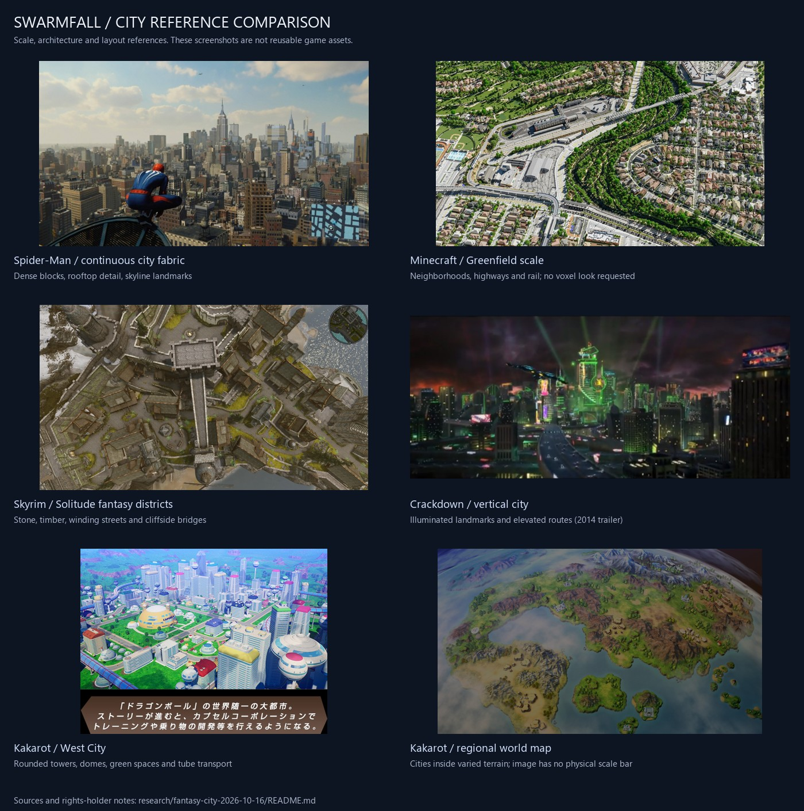

# Swarmfall: large city assets, scale and destruction

Researched October 16, 2026 by Codex (OpenAI). Owner references: Skyrim, sprawling Minecraft
cities (scale/intricacy only, explicitly less blocky), Spider-Man's New York, Crackdown and
Crackdown 3 destruction, Dragon Ball Z: Kakarot maps/destruction, and large elven/mythical cities.

The owner accepts realistic, alien-adapted, elven or other fantasy architecture. The priority
is a convincing **large, creative city**, not a handful of huts or a voxel appearance.
The most recent requested deliverable is this asset shortlist and the linked checklist work.
No city has been integrated into the running game in this research pass.

## Recommended choices

**Later owner feedback:** simple facade/medieval kits are too basic as the main target.
Prioritize elaborate authored architecture and complete scenes. The updated
[complex-scene shortlist and reusable module inventory](COMPLEX-SCENES.md) supersedes
the ranking below for the next visual-quality/import investigation. Keep this earlier list
as a supporting-module catalog.

Start with **Quaternius Downtown City MegaKit** for the strongest freely available route to
dense city blocks. Use **Poly Haven facades/materials** selectively for close views. For a
fantasy civilization, use **Quaternius Medieval Village MegaKit** as modular architecture.
**Synty Elven Realm** is the closest explicit elven-city option found, but it is a paid,
proprietary-license candidate, not a free public asset download.

These are building kits. None is verified here as a complete, free, ready-to-drop-in,
multi-kilometer city. We still need district layout, landmarks, roads, terrain integration,
distance-based detail, collision and testing. A demo scene is not proof of the requested scale.

| Priority / asset | What it provides and reference fit | Availability / license | Integration work / decision |
| --- | --- | --- | --- |
| **1. [Quaternius Downtown City MegaKit](https://quaternius.com/packs/downtowncitymegakit.html)** | 315 listed models; modular Boston/NYC-style blocks and seven example buildings. Best starting point for Spider-Man/Greenfield street density and a city later adapted to alien architecture. | CC0. Creator says roughly 60–70% is free; full/source editions are separate. FBX, Blend and glTF listed. | Shared texture sets help batching. Unity/Godot/Unreal source shaders and collision do not automatically transfer to three.js. Port window appearance and build our own simplified collision. **First free prototype choice.** |
| **2. [Poly Haven Modular Urban Apartments Facade](https://polyhaven.com/a/modular_urban_apartments_facade)** | Detailed contemporary facade modules, windows, doors and trim. Best material/detail supplement for convincing street-level flight. | Free CC0; glTF and other formats. Creator: James Ray Cock. | Full-resolution downloads are large; use selected modules, reduced textures and LODs. Not a complete building/city. **Use selectively near the camera.** |
| **3. [Quaternius Medieval Village MegaKit](https://quaternius.com/packs/medievalvillagemegakit.html)** | 304 listed models; modular interior/exterior walls, roofs, stairs, windows and vines. Best free foundation for Skyrim-like districts with custom castles/bridges. | CC0; roughly 60–70% free, additional/source editions separate. OBJ/FBX/Blend/glTF listed. | Assemble districts rather than scaling one village. Rework materials, tower silhouettes and landmarks for an alien/elven identity. **First free fantasy prototype choice.** |
| **4. [Synty POLYGON Elven Realm](https://syntystore.com/products/polygon-elven-realm)** | 700+ assets, 279 building pieces, curved/straight designs, cliffs, waterfalls, bridges and a detailed demo scene. Strongest explicit elven architecture match. | Paid proprietary license; listing showed US$199.99 when checked, subject to change. Unity/Unreal and FBX sources. | Requires purchase and conversion/material work. Source assets must not be placed in the public repository; review browser distribution against the purchased terms. Nothing purchased. **Optional paid choice.** |
| **5. [Quaternius Ultimate Fantasy RTS](https://quaternius.com/packs/ultimatefantasyrts.html)** | 128 buildings/nature assets in different evolution stages. Useful distinctive structures and civilization progression. | Free CC0; OBJ/FBX/glTF/Blend. | Good secondary landmarks/buildings, but stylized and not a ready-made metropolis. Official download folder inspected; listing saved locally, actual models not downloaded. |
| **6. [Kenney Fantasy Town Kit 2.0](https://kenney.nl/assets/fantasy-town-kit)** | 160 modular assets including arches, curved walls, roofs, fountains, vegetation and props. | Free CC0. Original ZIP and license downloaded into this research folder. OBJ/GLB/FBX included. | Lightweight prototype/dressing source. Inspected preview: simple, stylized pieces, **not** the final realism target or an assembled city. No runtime import yet. |
| **7. [Kenney City Kit (Commercial)](https://kenney.nl/assets/city-kit-commercial) + [City Kit (Roads)](https://kenney.nl/assets/city-kit-roads)** | Lightweight urban buildings plus street modules. Useful for block-layout experiments and distant city detail. | Free CC0; the word “Commercial” names the city-building category. | Stylized; use for layout/low-detail tiers rather than claiming Spider-Man-level realism. |
| **8. [Quaternius Modular Sci-Fi MegaKit](https://quaternius.com/packs/modularscifimegakit.html)** | 277 listed pieces for corridors, rooms, platforms and sci-fi details. | CC0; free subset and separate additional/source editions. | Useful alien dressing and selected interiors. **Not an exterior city kit** and not sufficient as the main city source. |
| **9. [Poly Haven textures](https://polyhaven.com/textures)** | Stone, plaster, concrete, metal and other PBR materials for weathering and consistent detail. | Free CC0; see [license](https://polyhaven.com/license). | Bake/atlas a limited material palette, downsize maps and adapt colors to each civilization. Materials alone will not fix layout or silhouettes. |

## Sources to hold back

- **[Spectra SourceCityToolkit](https://github.com/SpectraStudios/SourceCityToolkit_glb):**
  public GLB residences, markets and intersections. README says CC0 **with exceptions for
  textures.com photographs**, which cannot be assumed freely redistributable. Hold until
  individual materials are audited or replaced with verified CC0 alternatives.
- **[Epic City Sample Buildings](https://www.fab.com/listings/008fe959-5511-428e-93bd-f99b1179f6d5):**
  intricate city kit, explicitly UE-only; unsuitable for the current three.js/browser game.
- **[Greenfield map](https://www.greenfieldmc.net/conditions/):** useful scale reference;
  its conditions require permission for redistributed map sections. Do not treat the public
  download as an asset license. No permission request sent and no map downloaded.
- **Sketchfab complete cities:** a Monochrome Fantasy City listing was found, but its page
  could not be inspected (403). No verified license/archive; not approved for integration.
- **3DAssets.dev Fantasy MMO City:** listing surfaced in search but the source page returned
  503. Treat its claims as unverified and do not substitute it for a validated creator pack.
- No proprietary Skyrim, Spider-Man, Crackdown or Kakarot game files have been extracted.

## What each reference contributes

The following visual observations are design judgments from the saved screenshots, not
measurements of the games' world sizes. No kilometer figures or building counts are inferred.

| Reference | What the inspected view contributes | Swarmfall interpretation |
| --- | --- | --- |
| **Skyrim / Solitude** | Dense timber-and-stone architecture, winding lanes, towers, walls and bridges over a cliff. The saved image is a Nexus community/mod screenshot, not a claim about the unmodified game's exact layout. | Distinct fortified fantasy districts with terrain-aware placement and strong landmarks; expand district count for the owner's larger scale. |
| **Minecraft / Greenfield** | Long connected street/rail/highway networks, neighborhood blocks, vegetation and infrastructure extending across the view. | Scale, district variety and urban planning only. Use smoother authored geometry instead of voxels. |
| **Spider-Man / Manhattan** | Continuous city fabric, low/mid-rise buildings around skyline landmarks, detailed roofs and distant atmospheric depth. | Believable street blocks and a dense skyline; import licensed modular equivalents and add alien landmarks. |
| **Crackdown skyline** | Tall illuminated landmarks, elevated routes, strong colored silhouettes and layered movement space. Saved reference is from 2014 trailer coverage, not proof of final Crackdown 3 behavior. | Vertical city districts, recognizable navigation towers, elevated roads/bridges and alien lighting. |
| **Kakarot / West City** | Rounded towers, domes, horizontal facade bands, parks, a street grid and elevated tube transport. | Strong candidate for an original non-blocky alien-city silhouette language. Do not copy franchise logos/buildings. |
| **Kakarot world map** | Varied terrain, islands, mountains and separate settlement clusters across a stylized overview. | Regional/planet map hierarchy, with detailed city districts inside larger traversable landscapes. The overview has no scale bar; it cannot establish physical dimensions. |
| **Elven / mythical cities** | Owner's broader architectural direction; no specific “digital studio” project was identified. Synty's official Elven Realm gallery is an identifiable asset candidate. | Curved stonework, terraces, gardens, bridges and monument-scale towers where they suit the civilization. |

## Destructibility: confirmed facts and a practical proposal

**Crackdown 3:** Microsoft's launch coverage specifically describes Azure-powered,
fully destructible environments in **Wrecking Zone**, its two-team multiplayer mode.
Do not assume campaign and multiplayer have identical destruction, or that its cloud
infrastructure is included with a city asset pack.
[Xbox launch source](https://news.xbox.com/en-us/2019/02/15/crackdown-3-launches-worldwide-today-with-xbox-game-pass/),
[Microsoft technical context](https://ukstories.microsoft.com/features/microsoft-in-uncharted-territory-with-crackdown-3/).

**Kakarot:** Bandai Namco explicitly advertises destructible battlefields. Its official map
and West City screenshots show layout/appearance, not which buildings can collapse, whether
terrain deformation is persistent, or whether every structure is destructible. Those details
remain unverified here; do not promise fully destructible West City from these sources.
[Official feature description](https://en.bandainamcoent.eu/dragon-ball/dragon-ball-z-kakarot),
[official map/city gallery](https://dbar.bn-ent.net/field.html).

**Proposed browser implementation, not completed functionality:**

1. Give selected props/walls/buildings stable IDs, health and intact/damaged/ruined states.
   Start with one district. Prebuild broken geometry; show dust/debris with a strict budget.
2. Let damage change gameplay: openings, cover and obstacles must agree with troop navigation,
   drone clearance, targeting, pod landing and capture zones. Update saved checkpoints so
   reloading cannot restore destroyed buildings by accident.
3. Add limited chunk collapse for chosen structures after profiling. Use simplified collisions
   and a small active debris pool; settle/remove moving fragments into static rubble.
4. Consider structural supports/chain collapse in a dedicated smaller arena after the first
   tiers work. Full citywide physics/cloud multiplayer is a separate engineering project.

Most listed asset packs provide architecture, **not** a destruction system, fracture meshes,
structural-support simulation or browser physics integration.

## Implementation handoff

Current Aurex uses `map.half = 500`: a 1,000 m-wide gameplay square. The decorative skyline is
scattered separately (`scene.mjs`), not a connected street network. Increasing that number alone
would lengthen travel and change balance without creating a convincing city.

- Build deterministic districts and roads in a plain city-layout module. Separate playable
  districts from distant skyline so the current campaign need not be enlarged blindly.
- Convert a limited verified asset subset to optimized glTF/GLB; preserve original files/license
  here, publish only the necessary runtime files with credits. Batch repeated mesh/material
  combinations, use distance-based detail and section culling, and dispose resources on unload.
- Derive visible placement and collision from the same layout. Resolve FIX-02 flight clearance
  and FIX-03 troop navigation before filling drone routes with tall buildings.
- Add a clearly labeled local city preview so the owner can inspect scale and material/detail
  before it replaces Aurex. Show the real imported assets; don't call a placeholder a finished city.
- Validate high/low views, 360/390 px layouts, render time/draw calls/memory and reload behavior.
  Frame-rate targets and world-size budgets are to be measured, not claimed from screenshots.
- Archive the prior renderer/models/campaign values with matched screenshots before replacing.

## Local files and credits

`kenney_fantasy-town-kit_2.0.zip` is the unchanged creator archive downloaded from
https://kenney.nl/media/pages/assets/fantasy-town-kit/efe948d309-1754222374/kenney_fantasy-town-kit_2.0.zip .
`kenney/License.txt` states CC0 and credits Kenney. Extracted content and preview were inspected.
Quaternius download-list HTML/JSON is discovery evidence only; it is not the model pack.

`references/` contains local research screenshots. They are **not CC0 game assets** and must
not be copied into `dist/` or presented as our art. Source/credit mapping:

| File | Source / credit |
| --- | --- |
| `kakarot-world-map.jpg`, `kakarot-west-city.jpg` | [Official Bandai Namco field gallery](https://dbar.bn-ent.net/field.html); Bird Studio/Shueisha/Toei Animation, Bandai Namco Entertainment. Direct images: `/images/field/pc/map.jpg`, `/images/field/sp/map_a10.jpg`. |
| `skyrim-solitude.png` | [Nexus Solitude image 113908](https://www.nexusmods.com/skyrimspecialedition/images/113908), uploader account 17666954; game imagery belongs to its respective rights holders. |
| `spiderman-manhattan.jpg` | [AusGamers review](https://www.ausgamers.com/games/marvels-spider-man/review/), screenshot `Marvels_Spider-Man_20180829095646.jpg`; Marvel/Sony/Insomniac game imagery. |
| `crackdown-skyline.png` | [StudioYale 2014 trailer analysis](https://studioyale.blogspot.com/2014/06/crackdown-trailer-dissection.html), `Capture3.PNG`; Microsoft game/trailer imagery. |
| `minecraft-greenfield.jpg` | [Gamepressure Greenfield coverage](https://www.gamepressure.com/newsroom/500-players-have-been-building-city-in-minecraft-for-11-years/zf4b4e), image `403780210.jpg`; Greenfield project / Minecraft reference. Creator gallery download was blocked; this accessible coverage image was inspected instead. |

No generated imagery, paid purchases, messages to creators or game-asset ripping were used.
