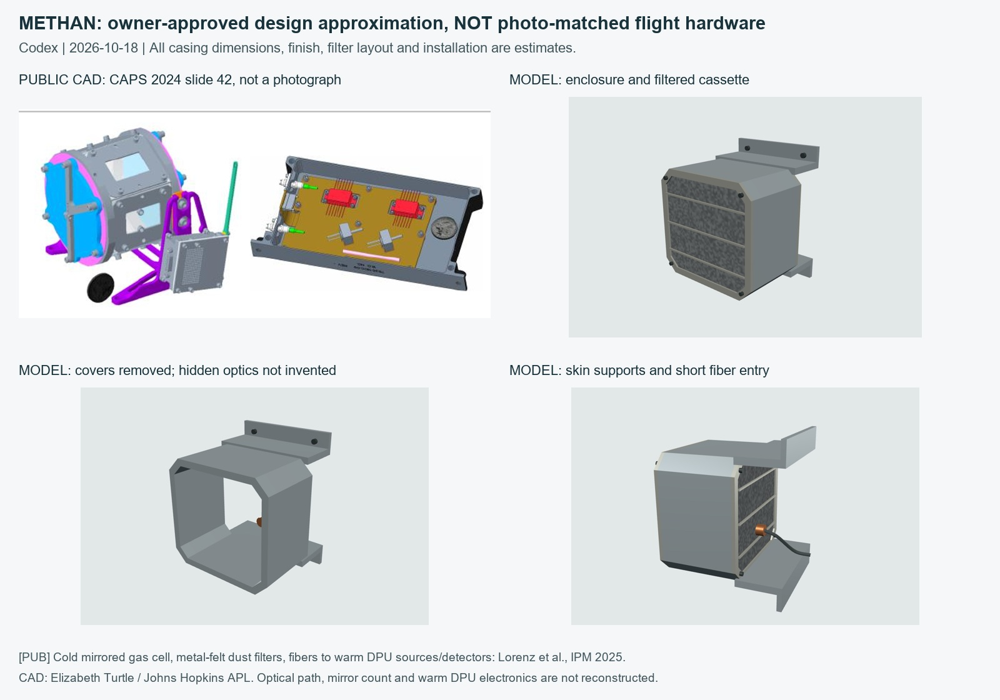

# Part 22 Closeout: Approved METHAN Design Approximation

October 18, 2026. Research, model and verification: Codex (OpenAI).
Owner explicitly chose **Build a labeled approximation** after the hardware-photo search.
This completes the initial asset pass for part 22, not a photo-verified flight replica.
Total initial passes: **19/24 (4 Codex, 15 Claude)**. Other authors' parts are unchanged.

## Evidence and Scope

- [Lorenz et al., IPM 2025, printed pp. 184-185](../sources/ipm2025-dragmet/README.md):
  exterior mirrored gas cell with metal-felt dust filtration; optical fibers through foam to
  in-band 1.67 micrometer and continuum superluminescent sources and photodiodes in the warm
  DPU light engine. This establishes architecture, not cell dimensions or internal optical path.
- [Turtle, CAPS 2024, slide 42](../sources/caps2024-dragmet/README.md): METHAN diagram and
  centimeter-class general enclosure arrangement. It is CAD, not a hardware photograph.
  Perspective and the pictured coin do not establish a precise flight dimension.
- [Seese et al., IPM 2025, printed pp. 186-187](../sources/ipm2025-efield/README.md):
  actual EFIELD engineering-model photo and published stalk/ball dimensions. The two EFIELD
  assemblies are unchanged in this closeout; do not misattribute their photo to METHAN.

The approved model is a source-constrained, chamfered enclosure interpretation: removable
inboard/outboard filter covers with estimated guard strips, mounting tabs/supports,
feedthrough and a short jacketed fiber entry. Neutral metal finishes replace CAD display
colors. This is not recovered flight CAD, a vendor product match or a claim of final build detail.

## Dimensions and Placement

All METHAN dimensions, material/finish and detailed placements below are **[EST]**.
Nothing in this table is a published flight dimension.

| Feature | Model value |
|---|---|
| Cell casing envelope, x/y/z | 0.062 / 0.100 / 0.105 m |
| Cell center in vehicle frame | (0.505, -0.100, -1.670) m |
| Skin attachment plane | x = 0.435 m |
| Chamfered frame edge | 0.006 m; 0.012 m corner cuts |
| Removable filter rims | 0.003 m thick |
| Filter cassettes | 2, inboard/outboard; count and orientation estimated |
| Filter material cue | Neutral procedural stippling, not measured pores |
| Jacketed fiber bundle radius | 0.0015 m; internal fiber count unspecified |
| Fiber end | Approximately 9 mm inside existing outer skin; full warm routing not drawn |

Existing model frame: +x starboard, +y up, -z forward. The supports meet the skin rather
than floating. The new dimensions are not constrained to preserve the old tiny box. Only
the new part was positioned; no neighboring rebuilt asset moved to accommodate it.

## Removable Layers and Unknowns

METHAN has casing, cover/filter, mount, interface and harness groups. Removing covers
reveals only the estimated enclosure, not an invented optical bench. Actual mirror count,
mounts/coatings, multipass length, fiber splitting and warm light-engine electronics remain
unmodeled. There are no fake circuit boards, exterior warm laser modules or visible beams.
Adjacent HYDRO/TEMP hardware in the CAD panel is not silently added as part of METHAN.

The part-22 Subassembly menu separately frames Front EFIELD, Rear EFIELD and **METHAN
(design estimate)**. Original part ID 22 remains. Layer masks preserve installed positions,
restore after draws/errors and do not leak to Pilot/Exterior. Thermal uses shared exterior
temperature for these exposed assemblies; no optical instrument solver or new science data
is introduced. Flight, power and thermal constants are unchanged.

## Verification

273 Node tests pass, including cell/skin mounting, filtered covers, fiber entry, explicit
estimate metadata, both EFIELD dimensions, all rebuilt-neighbor clearances, rotor swept
volumes, subassembly framing, stable numbering, mask restoration and matching 19/24 counts.
Real Edge/WebGL checks cover all three subassemblies at four orbit angles, Internal/Thermal,
1440/390/360 px screens, nonblank framed pixels, page errors and horizontal overflow.
Close-ups with cover fitted/removed and installed context are saved here.

The first texture draft incorrectly read as bands. The subsequent rectangular-casing draft
was refined to the diagram's chamfered silhouette. Both exact module/test drafts and pictures
are preserved in [the placeholder archive](../../archive/methan-placeholder-2026-10-18/README.md),
along with the exact preceding placeholder and UI files. Restore tag is on `e133dbf`.

## Follow-Ups

Real METHAN hardware photography and scale; exact flight dimensions, material, filter layout,
mounting and optical construction. If those emerge, archive this interpretation before
replacing it. Keep the approval and estimate labels; completion never means photo verification.
Continue the remaining numbered checklist one part at a time; do not alter other assets or
the other chat's city/game work. Publishing this closeout also includes the already-tested
per-probe selector checkpoint, previously backed up only on the feature branch.
