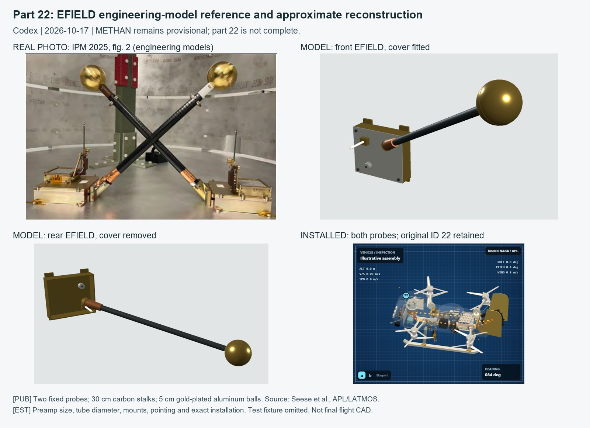

# Part 22: EFIELD Subpass, METHAN Still Open

October 17, 2026. Research, geometry and verification: Codex (OpenAI).
Do not count this as a completed replacement of all of part 22. Completed total stays
18/24: 3 Codex, 15 Claude. Earlier rebuilt assets remain credited to their authors.

## Sources and Appearance

- [Seese et al., IPM 2025](../sources/ipm2025-efield/README.md), printed pp. 186-187,
  PDF pages 187-188: figure 2 real engineering-model photograph for appearance; figure 1
  CAD and text for layout. Both original page images are saved and inspected.
- [APL DraGMet overview](https://www.jhuapl.edu/destinations/instruments/dragmet): suite role.
- [Turtle, CAPS 2024 slide 42](../sources/caps2024-dragmet/README.md): METHAN appears only
  as CAD. No new methane housing is claimed to match hardware.
- [Chatain et al., early EFIELD work](https://arxiv.org/abs/2211.01502): background only;
  use the newer 2025 published dimensions rather than the older preliminary boom size.

Photo-derived appearance: gold spherical electrodes, black carbon stalks, copper-colored
guard boots, low rectangular preamps, lid fasteners/tabs and co-mounted TEMP/MICRO.
The test stand, crossed assembly arrangement, calibration chamber and laboratory wiring
are omitted. Engineering models are not final flight configuration. Finish, fastener
counts and small fittings are approximations, not recovered manufacturing specifications.

## Parameters and Confidence

| Item | Value | Confidence |
|---|---|---|
| Fixed probe count | 2 | [PUB] |
| Carbon-fiber stalk length | 0.30 m each | [PUB] |
| Two-piece gold-plated aluminum electrode diameter | 0.05 m | [PUB] |
| Conductive stalk driven with guard voltage | No deployment mechanism | [PUB] |
| Front location | Upper starboard front | [PUB] region; [EST] exact pose |
| Rear location | Lower port rear near skid/MMRTG | [PUB] region; [EST] exact pose |
| Preamp envelope | 0.085 x 0.026 x 0.10 m in enclosure frame | [EST] |
| Stalk radius | 0.0055 m | [EST] |
| Front preamp center (x,y,z) | (0.45, 0.32, -1.64) m | [EST] |
| Rear preamp center | (-0.45, -0.22, 0.94) m | [EST] |
| Front/rear stalk direction before normalization | (0.45,0.45,-0.77) / (-0.75,-0.20,0.63) | [EST] |
| TEMP/MICRO on preamp | Co-location | [PUB]; drawn envelopes [EST] |
| METHAN retained gray box | (0.455,-0.12,-1.66), 0.05 x 0.07 x 0.09 m | Legacy [EST], not validated |

Model frame: +x starboard, +y up, -z forward. Case mounts contact the existing hull side
near x +/-0.435 m; current shell itself is approximate. Front estimated mount shifted
0.12 m forward from the first draft to clear the rebuilt DrACO transfer tube. Published
probe dimensions and every neighboring rebuilt asset stayed unchanged.

## Inspection and Limits

Each EFIELD assembly has independent casing, cover, mount, interface and harness groups.
Preamp enclosures have walls/floor and removable lids but no invented internal electronics.
Short harness entries terminate at the skin; no unsupported full internal routing is drawn.
Label 22 is anchored to the front preamp so it cannot jump to the empty midpoint between
the distant assemblies. One original part ID is retained. TEMP/MICRO here are atmospheric
instruments, not the battery/MMRTG sensor placeholders numbered 20 and 21.

Thermal uses the existing shared exterior node. No measured probe temperatures, electric
field values, guard-voltage behavior, ground charging or new science solver are implied.
Flight, power and thermal constants were not changed.

## Verification and Handoff

`tests/nose-sensors.test.mjs`: published sizes/count, front/rear pose, co-mounted devices,
independent layers without displacement, stable label anchor, METHAN preservation and
clearance against the already rebuilt parts and rotor swept volumes. All 252 Node tests pass.
Tube curves are checked as sampled volumes,
not one misleading bounding box around their full route. This is regression coverage of
the approximate installed model, not a CAD fit certification or flight qualification.

Screenshots include desktop/mobile, Internal/Thermal at four angles, installed context,
and close-ups for the photo comparison. Original blocks and the rejected mounting draft
are archived at [archive/nose-sensors-2026-10-17](../../archive/nose-sensors-2026-10-17/README.md).

Next: obtain a real METHAN hardware photograph and a scale reference. Do not check off #22
from this EFIELD-only pass, do not use CAD as a photograph, and do not alter published
probe lengths to clear legacy placeholders. Exact flight mounts, preamp boards and EVPS
slice are still open. Use the isolated sensor worktree; shared checkout has city work.
