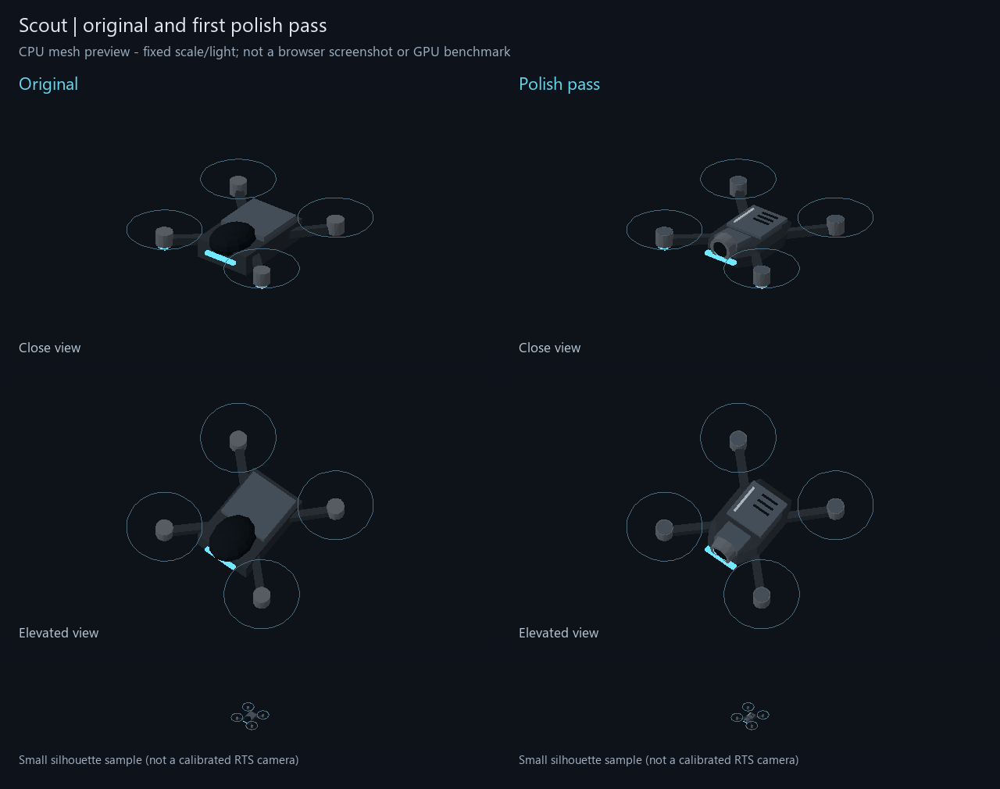

# ART-09 A1 — Scout hull and sensor polish

Implemented October 19, 2026 — **Codex (OpenAI)**. First small-asset cosmetic pass only;
**owner/browser visual acceptance and phone performance remain open**.

The Scout now has a tapered eight-sided hull with chamfered upper/lower bands, an inset
sensor lens inside an open rimmed housing, three deck grooves, one trim strip and capped
motor housings. It remains a light four-rotor drone with the existing squad-colored lamps.
All shapes are original illustrative gameplay art, not real hardware claims.

The comparison is drawn from actual old/new geometry using the included Node export and
Python/Numpy/Pillow rasterizer. It uses fixed orthographic cameras, simple Lambert light
and static rotor outlines. It is not a browser/GPU render, PBR material review, spinning
rotor preview, calibrated RTS camera or real-phone benchmark. Near and elevated views
were inspected; the small silhouette sample helps detect gross shape changes only.

| Contract | Result |
| --- | --- |
| Scale | 4.2, unchanged |
| Rotor anchor/radius arrays | Exact original four entries |
| Squad light geometry/colors | Exact original data |
| Body bounds | Stay inside the previous body envelope |
| Body/glow representation | Existing non-indexed vertex-colored geometry, same attributes |
| Geometry | 584 body + 36 glow = 620 triangles, previously 432 + 36 = 468 |
| Cost change | +152 triangles / 32.5% per shared template; 16,416 extra CPU attribute bytes |
| Scene batching | Existing body/glow/rotor instancing path; no new material or mesh batch |
| Gameplay and saves | No unit statistics, order, damage, flight, deployment or save schema changes |

The per-template CPU vertex increase is capped at 40% in an invariant check. This is a
bounded art-design budget, not measured GPU cost or a guarantee of unchanged frame times.
The test also verifies finite unit normals, the old body envelope, exact rotor anchors,
exact glow data and compatibility with existing scene attributes/instancing. The real
scene allocation/drop/release/disposal check continues to pass with the updated model.

**381/381 tests pass.** [Full output](test-results.txt). Browser access was previously
blocked and was not retried. Real visual acceptance, High/Light scene checks and phone
performance are still required. ART-09 remains unchecked: this implements only Scout's
first pass, not the entire review/polish backlog. Canonical count remains **23/305**.

[Original source, geometry, picture, inventory and lens draft](../../archive/scout-polish-2026-10-19/README.md)
are preserved. Reproduce previews with `export-scout.mjs` (output path argument) and
`preview.py`; the latter requires Numpy/Pillow and uses Windows Segoe UI. Original exported
geometry is stable; do not overwrite its archive when regenerating new comparisons.

Next: review Scout at real play/close distances before approving it. Link is the next
small candidate after Scout feedback; no other drone or defender was redesigned here.
